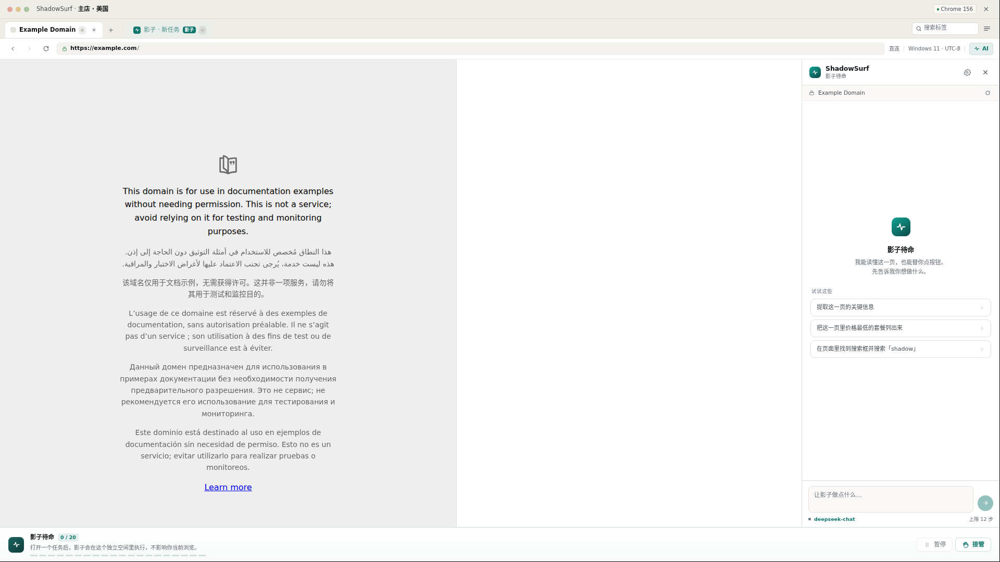
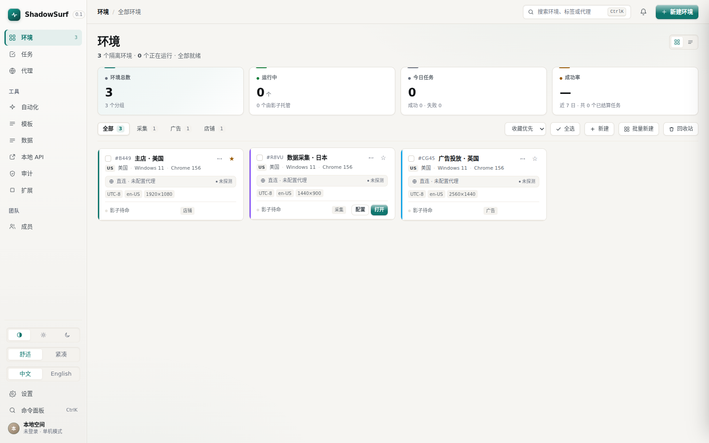
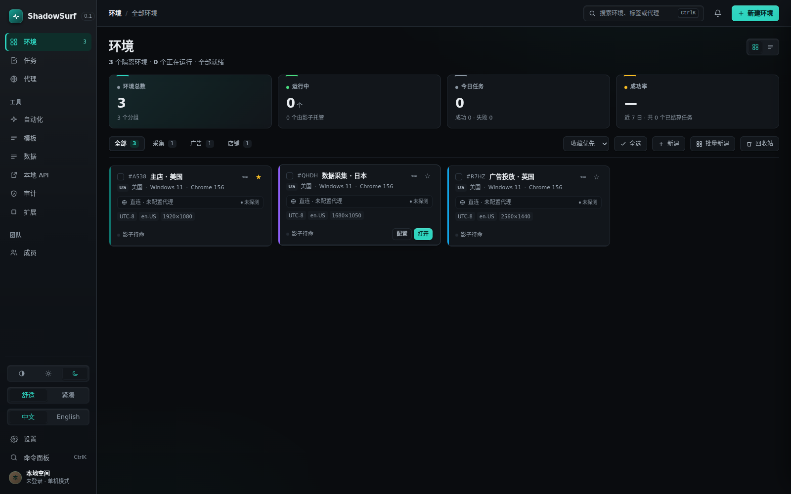
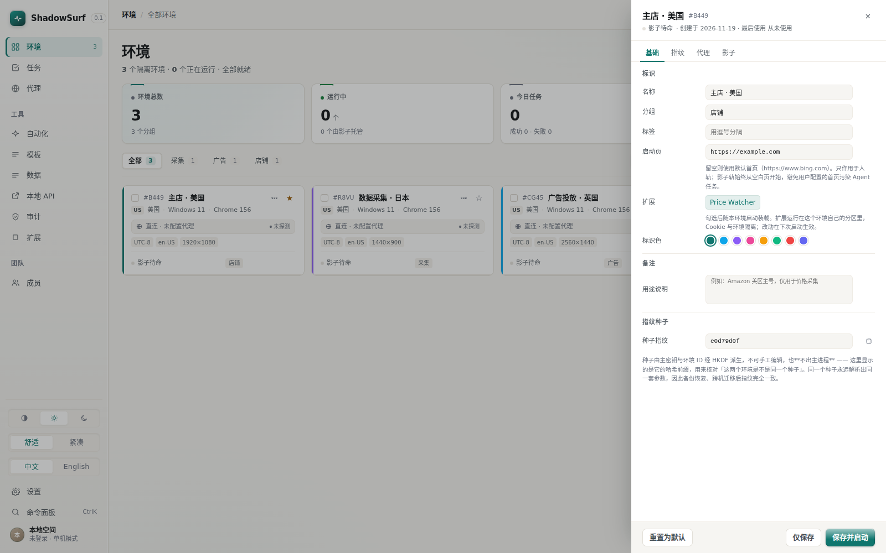
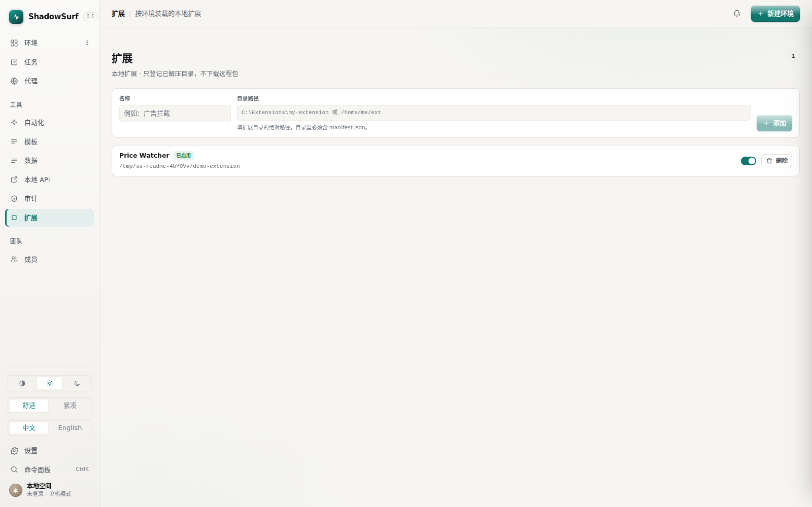
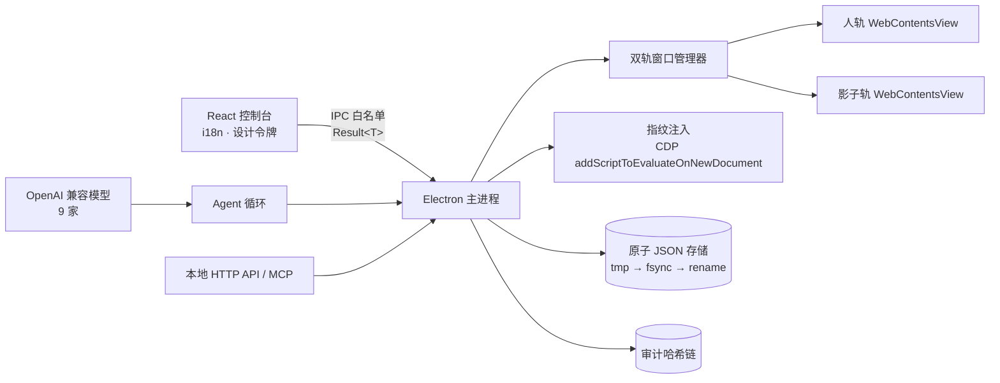

<div align="center">
  
  <h1>ShadowSurf</h1>
  <p><b>AI 原生浏览器 · 人机双轨的 Agent 工作台</b></p>
  <p>你照常冲浪，影子在另一个 Space 里把活干完。</p>

  <p>
    <a href="https://github.com/funny8kids/ShadowSurf/actions/workflows/build.yml"></a>
    
    
    
    
    
  </p>

  <sub>开源（MIT）· 零遥测 · 数据不出本机</sub>
</div>



---

## 为什么是 ShadowSurf

普通浏览器只有一个你。ShadowSurf 把每个环境拆成**两条轨道**：

- **人轨**：你自己浏览、登录、下单，保持手感不变；
- **影子轨**：Agent 在同一环境的另一个 Space 里观察、点击、填表、取数。

两条轨道共享同一个隔离环境（Cookie / Storage / 代理 / 指纹），但互不顶掉对方的标签页与回退栈。Agent 不再是一个停在侧边栏的聊天框，而是一个**能直接动手、且动手前要过闸门**的执行者。

三个设计底线：

| 底线 | 做法 |
|---|---|
| **指纹要经得起检测** | 40+ 面注入 + Worker / SharedWorker / ServiceWorker / OOPIF 同构覆盖；对 Pixelscan、CreepJS、BrowserLeaks 逐项对齐 |
| **身份不能悄悄丢** | 种子由主密钥 HKDF 派生，`safeStorage` 封装；换机 / 换账户导致解封失败时**明确报错**，不静默重建 |
| **不可逆动作必须留痕** | L2 动作（支付 / 下单 / 删除）走 OS 原生确认；审计是哈希链，闸门记录永不淘汰 |

---

## 界面一览

<table>
<tr>
<td width="50%"><br/><sub><b>控制台 · 亮色</b> — 环境卡片、分组标签、收藏优先、批量与回收站</sub></td>
<td width="50%"><br/><sub><b>控制台 · 暗色</b> — 跟随系统 / 亮 / 暗三档，全量设计令牌</sub></td>
</tr>
<tr>
<td width="50%"><br/><sub><b>环境抽屉</b> — 指纹、代理、启动页、扩展绑定，一致性评分实时计算</sub></td>
<td width="50%"><br/><sub><b>扩展管理</b> — 登记解压目录，逐环境勾选，启动时装进该环境自己的 session</sub></td>
</tr>
</table>

---

## 功能总览

### 环境与身份

| 能力 | 说明 |
|---|---|
| 环境管理 | 创建 / 克隆 / 批量新建（1–50）/ 编辑 / 软删除；分组、标签、备注、颜色、收藏置顶 |
| **环境回收站** | 软删除只停运行时、**不清分区**；恢复后登录态还在。彻底删除才清 `Partitions/ss_<id>`，且不可撤销 |
| 指纹生成 | 同一环境同一种子永远同一套参数；`regenerate` 才换身份（HKDF + 一次性 nonce） |
| 指纹模板 | 从任意真实环境保存整套指纹快照，可复用 / 删除；不预置任何模板，模板只含指纹，不含代理 / Cookie |
| 代理池 | http / https / SOCKS5（含 `socks5h` 远程 DNS、RFC 1929 认证）；CONNECT 隧道真实探测出口 IP / 时区 / 延迟 |
| **代理 → 地理校准** | 按出口国家自动写入时区 / 语言 / 地理坐标，只改与 IP 相关的三项，不动 UA / 屏幕 / WebGL |
| **扩展管理** | 只登记解压目录（校验 `manifest.json`、路径去重、可停用）；`Profile.extensionIds` 逐环境绑定，启动时经 `session.extensions.loadExtension` 装入，幂等且失败逐条回报 |
| 启动页 | 人轨使用配置的首页；影子轨始终从空白页开始，避免用户首页污染 Agent 任务 |

### 指纹与反检测

- **40+ 面**：UA / UA-CH、platform、屏幕与 DPR、Canvas、WebGL / WebGL2、WebGPU adapter、AudioContext、字体三通道、WebRTC、时区 / Intl / Date、地理坐标、plugins / mimeTypes、connection、battery、mediaDevices、permissions、mediaCapabilities、storage estimate、OffscreenCanvas……
- **跨执行上下文同构**：Dedicated / Shared / Service Worker 与 OOPIF 走同一份注入源，Worker 顶层脚本在读取指纹前完成接管。
- **三态噪声**：Canvas / Audio 支持 `noise` / `off` / `block`；`off` 不扰动、`block` 直接拒绝，语义分开而不是一个布尔量。
- **一致性自检**：页面内 16 项实测对照，输出 0–100 分与逐项失败原因；一致性不足会在界面上明确标红，不冒充「已伪装」。
- **可验证**：`npm run verify:injection`、`verify:worker`、`verify:shared-worker`、`verify:anticheat`（21/21）、`verify:fonts`、`verify:uach`、`verify:share`（9/9）。

### 自动化

| 能力 | 说明 |
|---|---|
| Agent 循环 | 快照（结构化可交互元素 `e1..eN`）→ 决策 → 执行 → 再观察；幻觉编号会被拒绝 |
| 双轨窗口 | 人轨 + 影子轨并排 / 分屏，可拖拽分栏；Agent 只在影子轨动手 |
| 脚本（RPA） | 从历史任务导入步骤，回放不走模型；语义选择器定位，不依赖 CSS |
| **定时任务** | 启动环境 / 运行脚本；间隔分钟或每日 `HH:MM` 二选一；手动 `runNow` 不推进周期 |
| **Cookie 预热** | 串行访问、随机停留 1.5–3s、单页 20s 超时；逐页结果与失败原因，写进环境自己的分区 |
| 本地 HTTP API | `/health`、`/v1/profiles`、`/v1/templates`、`/v1/scripts`、`/v1/audit/verify`、`/v1/proxies`、`/act`、`/snapshot`；只监听 `127.0.0.1` |
| MCP Server | stdio JSON-RPC，12 个工具；Bearer token 走环境变量；L2 动作回到同一确认闸门 |
| 本地团队 | 成员 / 四档角色 / 环境分享 ACL / 活动日志；纯本机 JSON，无登录、无云端 |

### 安全与审计

- **L0 / L1 / L2 风险分级**：L2（支付 / 下单 / 删除）需要 OS 原生确认窗；确认票绑定发起方，定时任务同样弹窗，闸门不被绕过。
- **伪装闸门**：`judgeMask` / `decideMaskGate` 判定表统一拦截；页面侧注入失败会禁用不可逆动作，状态不可静默回到 `ok`。
- **审计哈希链**：每条带前一条哈希，`verify()` 从头重算；闸门记录永不因容量淘汰，链头被裁剪单独判为 `head-truncated`。
- **种子保护**：主密钥经 `safeStorage`（Windows DPAPI）封装；`safeStorage` 不可用时明确降级并提示，而不是假装安全。
- **零遥测**：没有账号、没有云端同步、没有远程日志。

---

## 架构



- **渲染层**拿不到 `ipcRenderer`，只能调用 `preload` 暴露的白名单方法；`Result<T>` 在这一层拆包。
- **指纹注入**不依赖渲染层：主进程按环境生成脚本，落到 `Page.addScriptToEvaluateOnNewDocument`，新标签页与子框架自动生效。
- **存储**是带 schema 信封的原子 JSON；损坏文件进 quarantine 并在界面上可见，不静默重建。

---

## 快速开始

### 环境要求

- Node.js **22.15+**（`tests/*.test.ts` 使用 `module.registerHooks`）
- Windows 10/11（打包目标）；Linux / macOS 可从源码运行（未做 macOS 打包验证）

### 开发

```bash
npm ci
npm run dev        # electron-vite 开发模式
```

> Electron 45 的 npm 包不再声明 postinstall，首次 `require('electron')` 时会自动补装运行时（约 110 MB）。
> 在 CI / 无缓存环境里，可以在打包前显式执行 `node node_modules/electron/install.js`（流水线已经这么做）。

### 检查与验收

```bash
npm run typecheck  # 主进程 + 渲染层
npm test           # 328 项单元测试
npm run build      # production 构建到 out/
npm run verify:all # 全量门禁：注入 / 反检测 / 主题 / 字体 / UA-CH / 审计……
```

> `verify:*` 需要真实 Electron 与显示环境。Linux 无头机器可用 `xvfb-run -a npm run verify:injection`。
> 部分探针会用 SwiftShader 兜底 WebGL（`tools/gpu-flags.mjs`），无需独显。

---

## Windows 安装包与构建流水线

### 本地打包

```bash
npm run dist:win
```

产物在 `release/`：

| 文件 | 说明 |
|---|---|
| `ShadowSurf-<version>-win-x64-setup.exe` | NSIS 安装包，可选安装目录、桌面 / 开始菜单快捷方式 |
| `ShadowSurf-<version>-win-x64-portable.exe` | 便携版，双击即用，不写注册表 |

> 未做代码签名，Windows SmartScreen 会提示「未知发布者」。这是没有 EV 证书的必然结果，不是打包错误。

### GitHub Actions

[`.github/workflows/build.yml`](.github/workflows/build.yml) 会在以下时机运行：

- 推送到 `main` / 任意 PR：`typecheck → build → test:gate`（Ubuntu）
- 推送 `v*` 标签：额外在 `windows-latest` 上执行 `npm run dist:win`，上传安装包与便携版，并**自动创建 GitHub Release**
- 手动 `workflow_dispatch`

发布新版本：

```bash
git tag v0.1.0
git push origin v0.1.0
```

流水线会在 Releases 页面生成带两个 `.exe` 的版本，构建产物同时保留为 Actions Artifact（14 天）。

---

## 已知限制

- **没做真实模型长期联调**：Agent 机制用本地 mock 验证过完整链路，未跑过 10 步以上的真实任务；提示词还没被真实模型打磨。
- **网络层指纹做不到**：TLS/JA3、HTTP2、TCP 栈特征在 Electron 层无法伪造，要等内核 fork。
- **字体布局通道未拦截**：`document.fonts.check` 与 Canvas `measureText` 已接管；用 `<span>` + `offsetWidth` 的布局度量仍拦不住。
- **Service Worker 顶层脚本存在竞态**：只能在 install / activate / fetch 事件里注入，不写成「已覆盖」。
- **扩展只支持解压目录**：不下载、不上市场、不静默安装；换版本需替换目录后重启环境。
- **定时任务没有分组与补跑**：只支持「启动环境 / 运行脚本」，错过的时间点不会补。
- **迁移包导入非事务**：中途失败会留下部分数据，需要手动清理。
- **单窗口单任务**：同一时刻只允许一个 Agent 任务，多任务编排还没做。
- **存储是 JSON 不是 SQLite**：原子写 + schema 信封；接口按 DAO 设计，换 SQLite 不动上层。
- **云端同步 / 云手机 / Gecko / Android 明确不在范围**：需要服务端或新引擎线，取舍记录在 [docs/scope-decision.md](docs/scope-decision.md)。

---

## 文档

| 文档 | 内容 |
|---|---|
| [DESIGN.md](DESIGN.md) | 界面规范：不可判读状态、数据层修复验收项、穷举表 |
| [docs/scope-decision.md](docs/scope-decision.md) | 范围裁定：已实现 vs 技术上做不到 |
| [docs/competitive-parity.html](docs/competitive-parity.html) | 10 家商业指纹浏览器 × 10 项能力对照，含一手来源 |
| [docs/ui-parity-review.html](docs/ui-parity-review.html) | UI 对照评审：P0/P1/P2 与逐条证据 |
| [docs/index.html](docs/index.html) | 设计中心：原型、截图、文档入口 |

---

## License

[MIT](LICENSE) © 2026 Violet Notes

<div align="center"><sub>如果这个项目对你有用，欢迎 Star ⭐</sub></div>
